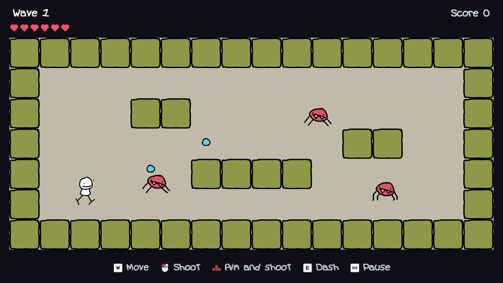
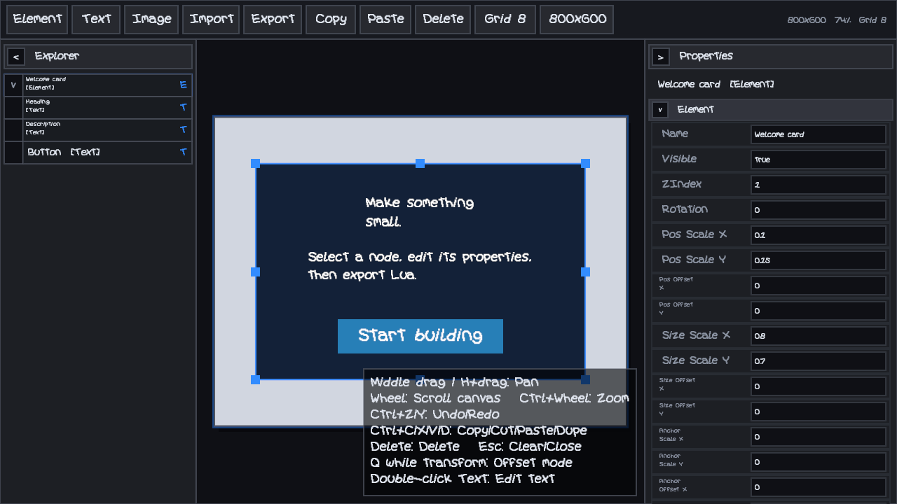
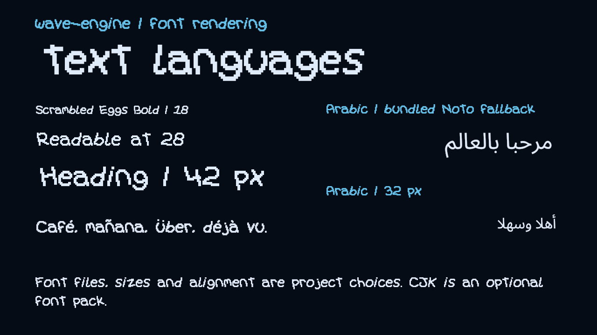
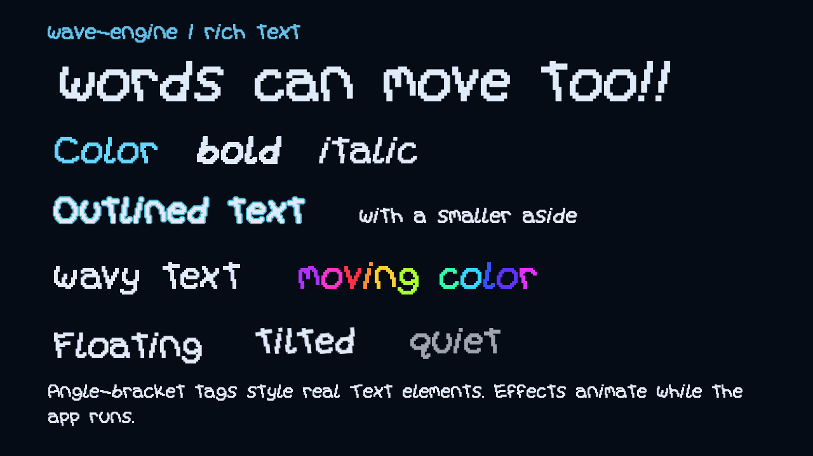

# wave-engine

wave-engine is a Lua/LÖVE2D framework developed through games, applications
and experiments. It brings together the parts those projects kept needing:
UI, text, input, audio, saved settings and a predictable update/draw pipeline.
Use it for 2D games, desktop tools and interactive prototypes, or opt into the
3D renderer and physics when your project needs them.

The engine and example projects live separately. You can work in this
repository or keep your application in its own repository with a pinned
engine dependency. The API is pre-1.0; existing compatibility globals are
still part of the public interface.

## Showcase gallery

These are captures of the bundled 2D example at 1280 × 720. The repository
also includes a 3D example, a sandbox built on the Robot 64 Engine place.

| 2D showcase | UI editor |
| --- | --- |
|  |  |
| A room shooter with animated sprites, generated sound and input prompts. | Edit a hierarchy, preview layouts at different sizes and export Lua. |

| Font rendering | Rich text and markup |
| --- | --- |
|  |  |
| The showcase’s Scrambled Eggs Bold font, Latin accents and an Arabic fallback. | Colors, outlines, font sizes and per-glyph effects. Run the example to see the animation. |

## Features

- Project configuration and callbacks, with named update and draw stages.
- UI trees with scale/offset layout, anchors, clipping, scrolling, images,
  text editing and pointer interaction. A built-in editor exports Lua.
- Cached fonts, optional fallback packs, multilingual text, outlines,
  inline styling, images and animated text effects.
- Keyboard, mouse, gamepad and touch actions, rebinding, prompt sprites,
  rumble and mouse capture.
- Music and sound channels, generated sound effects, saved settings,
  accessibility filters and a pause/settings menu.
- Optional ENet networking and an optional RBX renderer with scene import,
  materials, rigid-body physics, raycasts and character controllers.

## Quick start

Install [LÖVE 11.5](https://love2d.org/) with its bundled LuaJIT. Download this
repository as a ZIP and extract it, or clone the URL from GitHub's **Code**
button:

```sh
git clone https://github.com/tangeloworks/wave-engine.git
cd wave-engine
```

Run `love .` from the repository root. [conf.lua](conf.lua) selects the
project to start; the repository ships with `showcase2d` selected.

No Lua package installation, Roblox account or extra download is needed. On Windows, if LÖVE is not on your PATH, use PowerShell:

```powershell
& 'C:\Program Files\LOVE\love.exe' .
```

The shooter starts by default. Use WASD to move, the arrow keys or left
mouse button to aim and fire, E to dash and Escape to pause. Gamepads
use the left and right sticks, RB to dash and Start to pause. F6 opens input
rebinding.

For the typography examples or editor, change the
`demo` literal in [projects/showcase2d/config.lua](projects/showcase2d/config.lua)
to `"fonts"`, `"markup"` or `"editor"`, then restart. Set it back to `"game"`
for the shooter.

For the Robot 64 sandbox, change the first setting in [conf.lua](conf.lua):

```lua
local selected_project = "showcase3d"
```

Move with WASD or the left stick, jump with Space or A, rotate the camera
with the right stick or by holding the right mouse button, and zoom with the
wheel. R respawns; Escape pauses. The scene and its credits are in
[projects/showcase3d/robot64](projects/showcase3d/robot64/NOTICE.md).

Windows with LÖVE 11.5 is tested. Linux, macOS, mobile builds and other LÖVE
versions are not verified for this release. Touch support exists, but this
is not a claim that the desktop examples are ready to ship on phones.

## Creating a project

Create `projects/mygame/config.lua`. Configuration loads before LÖVE's
modules start, so keep it a plain Lua table:

```lua
return {
    id = "mygame",
    title = "My game",
    identity = "my-game",
    window = { width = 1280, height = 720, resizable = true },
    background_color = { 0.06, 0.08, 0.12, 1 },
    assets = {
        image_roots = { "projects/mygame/assets/images" },
        font_roots = { "projects/mygame/assets/fonts" },
        audio = "projects/mygame/assets/audio",
    },
}
```

Then create `projects/mygame/main.lua`:

```lua
local project = require("projects/mygame/config")

function project.start(program)
    project.button = Text {
        text = "Click me", font = "Poppins-Regular", fontSize = 28,
        position = { scale = vec2(0.5, 0.5) },
        anchor = { scale = vec2(0.5, 0.5) },
        size = { offset = vec2(240, 72) },
        show_fill = true, fill_color = { 0.12, 0.40, 0.58, 1 },
        mousecheck = true,
        on_mouse_clicked = function(self, button)
            if button == 1 then self:setText("Hello!") end
        end,
    }
end

function project.update(program, dt) end

function project.draw(program)
    project.button:draw()
end

return project
```

Set `selected_project = "mygame"` in the root configuration and run `love .`.
The folder name and project ID must match; use letters, digits, underscores
or hyphens. If the selected project is absent, the launcher chooses the first
valid project alphabetically.

The engine owns the LÖVE callbacks. Put application work in the descriptor:
`start(program)` runs once after an optional splash, `update(program, dt)`
runs each frame, and `draw(program)` draws inside the presentation pipeline.
Optional `resize(program, width, height, graphics_reset)`, `keypressed`,
`mousepressed`, other input callbacks and `quit(program)` receive the program
first. Return true from `quit` to cancel closing.

The program is also available as `G`. The launcher creates `Element`, `Text`,
`Image`, `vec2`, `input_mgr` and `audio` before calling `start`. One engine
runtime owns these globals per LÖVE process.

Larger projects can register stages instead of putting everything in one
callback:

```lua
G.pipeline:register("update", "simulation", function(dt)
    -- Update your simulation here.
end, { priority = 2, after = "INIT" })
G.pipeline:register("draw", "hud", function()
    project.button:draw()
end, { phase = "interface", priority = 30 })
```

Use either the descriptor draw or a stage for a given object. Draw phases
run in order: content, interface, overlays, then compositing. Within a draw
phase, higher priorities run first; `after` specifies an ordering dependency.
The engine applies display scaling and accessibility settings to the result.

Set `assets.default_font` to a filename in `assets.font_roots` to give the
project’s text and shared UI a default typeface. Showcase2D uses this for
Scrambled Eggs Bold.

Project image/font roots are searched before engine defaults. Explicit LÖVE
virtual paths also work. Keep your media in your project; the engine asset
folder contains shared fonts, the default icon and input prompts. For explicit
lookup and useful missing-file errors, use `require("engine/assets").new({
project_root = "projects/mygame/assets" })` and its `resolve`, `image`, `font`
or `source` methods. Absolute filesystem paths are not asset paths.

Engine preferences live in the project's LÖVE save directory. Set defaults
with `settings` in the descriptor, read them through
`CFG:getSetting("musicvol").value`, and change them with
`CFG:getSetting("musicvol").set(5)`. Declare project preferences in
`custom_settings` and use `program:getCustomSetting(name)` and
`program:setCustomSetting(name, value)`. `no_save_mode = true` skips game and
settings persistence; input bindings remain separate device preferences.

## Graphics and UI

`Element` is a layout and interaction node; `Text` and `Image` extend it.
A position or size combines a fraction of the parent (`scale`) with logical
pixels (`offset`). An anchor chooses the point on the element placed at that
position. Add children with `parent:add(child)` and draw the root once.

```lua
local panel = Element {
    position = { offset = vec2(24, 24) },
    size = { offset = vec2(320, 120) },
    show_fill = true, fill_color = { 0.1, 0.14, 0.2, 1 },
}
panel:add(Image {
    source = "iconimg.png", -- shared engine icon; project roots can override it
    size = { offset = vec2(64, 64) },
    position = { offset = vec2(16, 28) },
})
panel:add(Text {
    text = "A small panel", fontSize = 24,
    position = { offset = vec2(96, 24) },
    size = { offset = vec2(200, 72) },
})
-- Call panel:draw() from your project's draw callback.
```

Use `mousecheck = true` with `on_mouse_clicked`, `on_mouse_enter` and
`on_mouse_leave` for pointer controls. `on_draw(self, size)` draws custom
content in an element's coordinates. `element:remove()` detaches a tree.
Images support sprite rectangles through `setImageRect(offset, size)`,
flipping through `setFlip(x, y)`, and `resample_mode = "linear"` or `"nearest"`.
See [element.lua](engine/graphics/element.lua) for flow layouts, clipping and
scrolling, and [image.lua](engine/graphics/image.lua) for the image API.

[Menu](engine/ui/menu.lua) provides action rows, toggles, choices and sliders.
It handles mouse, keyboard and gamepad navigation and scrolls long lists.
The 2D showcase includes settings and accessibility pages: color-vision
filters, grayscale, contrast, gamma, brightness and reduced motion.

## UI editor

Set `use_ui_editor = true` in a project descriptor to load the editor during
startup. The showcase's `demo = "editor"` setting does this and opens an
editable example without running the shooter underneath it.

- Create an Element, Text or Image with the toolbar. New nodes become
  children of the selection; press Escape to clear selection first if you
  want a root node.
- Select items in the preview or Explorer. Drag to move, use the handles to resize,
  or edit scale, offset, size and anchor values in Properties.
- Use the context menu or Explorer drag to reparent nodes. Edit text,
  alignment and colors, or choose an image source. Project-relative image
  paths are portable; external image previews do not copy files into a project.
- Cycle the preview resolution, including the phone preset. Use the wheel
  to pan, Ctrl+wheel to zoom, and middle-drag or H+drag to pan freely.
  The side panels collapse; the toolbar wraps in narrow windows.
- Ctrl+Z/Y undo and redo. Ctrl+C/X/V copy, cut and paste the selection;
  Ctrl+D duplicates it. Delete removes it. Double-click text to edit it.

**Export** copies Lua to the system clipboard. Save it as a Lua file in your
project; the returned list contains the root elements. Draw each root from
your project. **Import** reads exported Lua from the clipboard. There is no
autosave or file-based project browser. Import only trusted code.

Application code can use `require("engine/ui/editor").export()` and
`editor.import(source)`. Export preserves the editable hierarchy, transforms,
image settings, font paths and supported text styling. It does not serialize
application event handlers or every advanced layout setting. The preview is
for layout and appearance, not a separate game simulation.

## Fonts and rich text

Font names resolve in the configured roots. Supply a font path or a LÖVE
Font object when you need a specific typeface. Poppins Regular and Black are
bundled; choose the Black font file for that weight. The `bold` style adds a
synthetic stroke and does not select a real font weight.

```lua
local label = Text {
    text = "Hello / مرحبا بالعالم",
    font = "Poppins-Regular", fontSize = 28,
    size = { offset = vec2(520, 120) },
    textAlignX = "left", textAlignY = "center",
    wrapMode = "word", clayWrap = true,
    outlineThickness = 1, outlineColor = { 0.02, 0.03, 0.05, 1 },
}
-- Draw label in your project; change its contents with label:setText("...").
```

`fontSize` sets the base size. `textScaled = true` fits text into its box;
`textFits = false` prevents fitting from enlarging it. `textScale` multiplies
the result. Word wrapping uses the available element width when `clayWrap`
is enabled; use `clayWrap = false` with `maxWidth` for an explicit limit. `wrapMode = "none"`
disables word wrapping. Horizontal alignment is `left`, `center` or `right`;
vertical alignment is `top`, `center` or `bottom`. `lineHeight` and
`letterSpacing` control spacing.

The font manager caches fonts and fallback chains. Text caches static content,
updates animated glyphs separately, and rerasterizes file fonts for display
scale and DPI changes. Supplied Font/ImageFont objects cannot be resized from
a source file. `pixelFont = true` selects nearest filtering for pixel fonts;
smooth fonts use linear filtering. Display behavior still depends on the
font, LÖVE build and graphics driver.

An Arabic fallback font ships with the engine. The gallery exercises
Latin accents and Arabic joining without HarfBuzz installed.
Arabic diacritics are removed by default by the Arabic helper. Mixed-direction
text and complex scripts need testing with your actual strings; this is not a
complete Unicode shaping or bidirectional-layout implementation. Optional
HarfBuzz bindings are detected, but are not bundled or verified here.

CJK is optional. Add an appropriately licensed font to a project font root,
or install the [Noto CJK font](https://github.com/notofonts/noto-cjk/blob/main/Sans/OTF/Japanese/NotoSansCJKjp-Regular.otf) as
`NotoSansJP-Regular.otf`. The engine checks whether fallback files exist and
starts without them. For custom fallback chains, use LÖVE's `Font:setFallbacks`
on your own Font object. [font_manager.lua](engine/graphics/font_manager.lua)
contains the lower-level cache and loading APIs.

### Markup syntax

Markup uses angle brackets, with matching close tags in nested order:

```lua
local label = Text {
    text = "<color=#65d6ff>Blue</color> <bold>bold</bold> " ..
           "<wave=5,2>moving text</wave>",
    font = "Poppins-Regular", fontSize = 32,
    size = { offset = vec2(700, 100) },
}
```

The parser restores the previous style for each closing tag; it does not
validate the closing tag's name. Use `richText = false` for literal text
containing angle brackets. These handlers exist in [text.lua](engine/graphics/text.lua):

| Tags | Values / behavior |
| --- | --- |
| `color`, `outlineColor` | Named color, `#RRGGBB`, `#RRGGBBAA` or comma-separated 0–1 components |
| `outlineThickness`, `blockOutline` | Stroke width; block-shaped stroke switch |
| `bold`, `italic` | Optional numeric effect amount |
| `size`, `font`, `pixelFont` | Font size, font name/path, nearest-filter switch |
| `opacity`, `rainbow` | Opacity or animated color; optional `fill`/`stroke` scope |
| `wave`, `shake`, `wavy`, `jingle`, `loop`, `worm` | Amplitude and frequency, e.g. `<wave=5,2>` |
| `tremble`, `float`, `rotate`, `scale` | Amount; amplitude/frequency/axis; angle/speed; X/Y scale |
| `backdrop`, `dropshadow` | Backdrop/shadow parameters parsed by `parseBackdrop` |
| `img` | Image path and size, e.g. `</img>` |
| `shader` | Built-in `wave`, `glitch`, `distort`, `pixelate`, `chromatic`, or a project shader |

For example, `<rainbow=0.4,0.7,fill>color</rainbow>` changes the fill over time.
`<color=#65d6ff,fill>` changes only the fill; without a scope, `color` changes
both fill and stroke. Custom shaders resolve under `assets.shader_roots`.
Their uniforms and parameter handling are defined in the shader loader in
[text.lua](engine/graphics/text.lua); there is no public arbitrary-tag
registration API.

`label:play("typewriter", { speed = 0.05 })` reveals one glyph every 0.05
seconds. `onCharacter` and `onComplete` callbacks are optional. The regular
engine update pipeline advances text animations.

## Input and audio

Define actions in the configuration's `actions` table or at startup:

```lua
input_mgr.define_action("dash", {
    keyboard = { "lshift", "e" }, joy = "rightshoulder",
})
input_mgr.add_key_handler("dash", {
    pressed = function() print("dash") end,
})
-- Poll during update:
local x, y = input_mgr.controller.get_active_direction_xy()
```

Bindings accept LÖVE key/gamepad names, `mouse1` through `mouse5`, and `l2`/`r2`
for triggers. Player rebinds take precedence over defaults. Multiple actions
can share a key. `input_mgr.mouse.set_look_active(true)` captures camera input;
`consume_look_delta()` reads it, and setting look active to false releases it.
Focus loss also releases capture.

Audio files under `assets.audio/music/` and `assets.audio/sfx/` are registered
by filename without the extension. Use `audio:play("music", "theme", { loop =
true })` for a project-owned `theme.ogg`. Missing optional audio folders are
fine. The public shooter generates its sounds:

```lua
local Synth = require("engine/services/synth")
audio.channels.sfx:add_sound("blip", Synth.render({
    wave = "square", freq = 880, freq_end = 440, duration = 0.08,
}))
audio:play("sfx", "blip", { clone = true })
```

Channel levels follow master, music and sound-effect settings. Local showcase
music is excluded because its redistribution terms are not recorded.

### Optional networking

`require("engine/networking")` loads the ENet transport on demand. Create a
server with `network.host({ port = 22122 })` or a client with
`network.join({ address = "127.0.0.1", port = 22122 })`. The module hooks into
the running engine pipeline. Outside that runtime, call `network.update(dt)`.
Close endpoints with `endpoint:close()`. See the module header for events,
state replication and optional LAN discovery. The loopback path is tested;
Internet deployment, authentication and game-specific validation are your
application's responsibility.

## RBX renderer and physics

The RBX stack loads only when requested. Ordinary 2D startup does not
initialize it. The renderer, physical materials and reusable character and
follow-camera controllers can be used on their own; `showcase3d` shows them
together with a full place file.

Inside your project's `start` callback:

```lua
local rbx = require("engine/graphics/rbx")
local world = assert(rbx.new({ quality = "balanced", simulate_physics = true,
    physics_rate = 120 }))
local V = rbx.Vector3
world.Instance.new("Part", {
    Parent = world.Workspace, Anchored = true,
    Size = V.new(40, 2, 40), Position = V.new(0, -1, 0),
    Material = "Concrete", Color = rbx.Color3.new(0.4, 0.6, 0.7),
})
world.Instance.new("Part", {
    Parent = world.Workspace, Shape = "Ball", Anchored = false,
    Size = V.new(2, 2, 2), Position = V.new(0, 8, 0),
})
local camera = world.Workspace.CurrentCamera
camera.CameraType = rbx.Enum.CameraType.Scriptable
camera.CFrame = rbx.CFrame.lookAt(V.new(0, 10, 24), V.new(0, 2, 0))
G.pipeline:register("update", "world", function(dt) world:update(dt) end,
    { priority = 2, after = "INIT" })
G.pipeline:register("draw", "world", function() world:draw() end,
    { phase = "content", priority = 50 })
project.world = world -- call project.world:Destroy() in project.quit
```

Parts are anchored by default in this engine; set `Anchored = false` for
moving bodies. Quality presets are `performance`, `balanced` and `quality`.
Physics supports contacts, friction, elasticity, BodyMovers, raycasts, touch
events and sleeping. `world.RunService.FixedHeartbeat` runs per physics step;
frame events run once per update. This is an independent implementation with
Roblox-style APIs, not a full Roblox runtime or a promise of identical behavior.

Load a `.rbxl` or `.rbxlx` place with `map_path` in the constructor. Assets
resolve in the place's `<filename>.assets/` sidecar and the explicit
`asset_root`. Remote downloads default to off. Missing external textures
leave untextured materials; unreadable collision meshes retain box collision
with warnings. Only distribute places and assets you have permission to ship.

Materials work without a texture pack. Color, surface response and physical
properties remain available. To supply your own textures:

```lua
local options = {
    materials = {
        Concrete = { color = "projects/mygame/assets/grid.png", studs_per_tile = 8 },
        Neon = false,
    },
    material_roots = { "projects/mygame/assets/materials" },
}
-- Pass options to rbx.new(). A material folder may contain color.png and
-- optional normal.png, roughness.png and metalness.png.
```

Lookup checks explicit overrides, material roots, then the asset root's
materials folder. Missing maps warn and use untextured defaults; textures do
not change density, friction or elasticity.

For mesh/union collision, call
`require("engine/graphics/rbx/runtime/mesh_collision").prepare(world, world.Workspace)`
after loading and before simulation. It uses stored collision data where
available, otherwise prepares convex hulls/decompositions and caches them in
the save directory. Decompositions are approximate; compound mass and inertia
still use box estimates.

The [character controller](engine/graphics/rbx/controllers/character.lua)
provides `Character.new`, `pre_simulation`, `set_input` and `queue_jump`.
Connect `pre_simulation` to `FixedHeartbeat` and give the
[follow camera](engine/graphics/rbx/controllers/follow_camera.lua) a target.
The [touch helper](engine/graphics/rbx/controllers/touch.lua) adds filters and
cooldowns to triggers. Public types/options are documented in
[public_types.lua](engine/graphics/rbx/public_types.lua) and
[public_options.lua](engine/graphics/rbx/public_options.lua).

## Standalone projects

Keep a game in its own repository and pin the engine as a Git submodule:

```sh
git submodule add https://github.com/tangeloworks/wave-engine.git vendor/wave-engine
git submodule update --init --recursive
```

Your application owns its root `conf.lua`:

```lua
function love.conf(t)
    t.version = "11.5"
    t.identity = "my-standalone-game"
    t.window.title = "My game"
    t.window.width, t.window.height = 1280, 720
    t.window.resizable = true
    t.window.depth, t.window.stencil = 24, 8
end
```

And its root `main.lua`:

```lua
local wave = require("vendor/wave-engine/bootstrap")
return wave.run({
    id = "my-game",
    start = function(program)
        -- Create your application here. Engine globals are now available.
    end,
    draw = function(program) end,
})
```

The bootstrap resolves engine modules, shared assets and worker paths under
the submodule in both folders and `.love` archives. Your project's paths stay
relative to your own root.

A project written for this repository's `projects/<name>/` layout can move to
its own repository: keep it at `projects/<name>/`, have `conf.lua`
set `_G.WAVE_PROJECT_NAME` and load `projects/<name>/config` as this
repository's `conf.lua` does, and start it from `main.lua` with
`wave.start("<name>")`. Worker threads start without the bootstrap's module
loader; a project thread that requires engine modules should first run
`love.filesystem.load("vendor/wave-engine/engine/mount.lua")()("vendor/wave-engine/")`.

Clone applications with `--recurse-submodules`. Dependabot's `gitsubmodule`
ecosystem can open a pull request whenever the engine changes. To update by
hand, check out the new commit and commit the dependency pointer:

```sh
git -C vendor/wave-engine fetch origin
git -C vendor/wave-engine checkout <tag-or-commit>
git add vendor/wave-engine
git commit -m "Update wave-engine"
```

## Tests

The engine regression suites cover the RBX scene model, materials, physics
contacts, queries and renderer bookkeeping. Run them from the repository root:

```sh
RBX_TEST=1 love .          # headless, skips suites that need a window
RBX_TEST=graphics love .   # includes the rendering suites
```

In PowerShell, set `$env:RBX_TEST = '1'` and run `lovec.exe .` to see the
output. `RBX_TEST_ONLY=<text>` limits the run to suites whose file name
contains the text. The process exits with a non-zero status on failure.

`WAVE_SMOKE_FRAMES=<n>` starts the selected project normally, runs `n`
frames and exits; an error exits with status 1 instead of opening the error
screen. Standalone projects can enable the same check by calling
`require("engine/runtime/smoke").from_environment()` after starting the
engine. GitHub Actions runs the headless suites and a showcase smoke test on
every push and pull request.

## Packaging

Package from a clean checkout or source ZIP so private and ignored local
files cannot slip into the archive. Select `showcase2d` in `conf.lua` for the
public 2D example. From that clean folder, Python's standard ZIP command can
create a `.love` file without a build script:

```sh
python -m zipfile -c ../showcase.love main.lua conf.lua bootstrap.lua LICENSE engine projects
love ../showcase.love
```

The command does not apply `.gitignore`, so run it from a clean checkout
rather than a development folder with local music, private projects or other
ignored files. Add optional font packs only when your application needs them,
and review new assets and their licenses before packaging.

For a standalone application, zip your application root and its checked-out
engine dependency, with forward-slash archive paths and no enclosing folder.
Use a clean dependency checkout so private or ignored local files cannot slip
into the archive. Keep the engine's license and bundled dependency licenses alongside
its source. LÖVE's executable and libraries are not included in `.love` files;
fused executables must also include LÖVE's own `license.txt`.

## Contributing and licensing

Bug reports, focused fixes and documentation corrections are welcome. Include
your operating system, LÖVE version, error output and a small reproducible
project. See [CONTRIBUTING.md](CONTRIBUTING.md) for the short workflow.

On Windows, use `lovec.exe` to see console output while running a project.

wave-engine's own code is [MIT licensed](LICENSE). Bundled dependencies,
fonts and input prompts retain their own licenses; they are listed in
[THIRD_PARTY_NOTICES.md](THIRD_PARTY_NOTICES.md). Preserve the license files
and attribution bundled with them. Release changes are in
[CHANGELOG.md](CHANGELOG.md). Report security problems as described in
[SECURITY.md](SECURITY.md).
